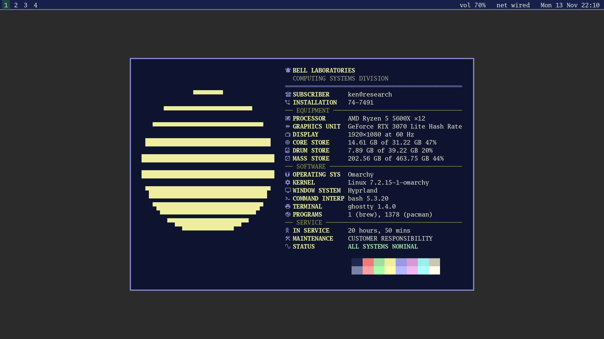
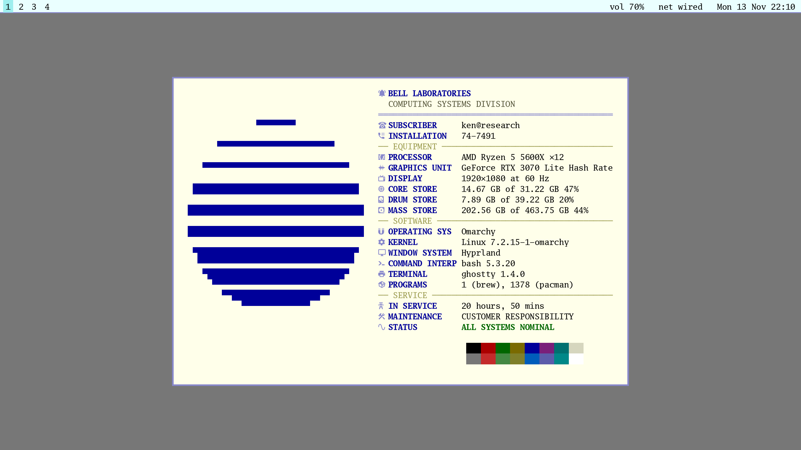

# Bell Labs

A desktop theme taken from what Bell Labs actually ran: the yellow paper of
**acme**, the grey desktop of **rio**, the **Go Mono** typeface by Bigelow & Holmes
(the same designers as Lucida, the typeface of Plan 9) and the plain-text
labels of a 1970s teletype.

There are two variants, built from the same templates:

| | |
|---|---|
| **Bell Labs** | acme paper: Plan 9's pastels as the page, black ink. |
| **Bell Labs Night** | the same Plan 9 pastels as ink on a deep Bell-System navy. |




The palettes (`palettes/*.toml`) and the templates render the same way from a
shell script or from Nix, so the theme works the same on Omarchy, NixOS, or any
distro with niri or Hyprland.

## Installing

```bash
git clone https://github.com/agustinrojas1/bell-labs-theme
cd bell-labs-theme
./install-omarchy.sh     # Omarchy (see below)
./render.sh              # anything else: configs land in out/
```

For NixOS, see [NixOS + Home Manager](#nixos--home-manager).

## The palettes

The interface colours are the **literal values from Plan 9's `libdraw`**
(`include/draw.h`), as `acme.c` assigns them:

| Plan 9 name | Hex | Light | Night |
|---|---|---|---|
| `DPaleyellow` + white | `#FFFFEA` | page | brightest ink |
| `DPalebluegreen` + white | `#EAFFFF` | tag line / bar | — |
| `DDarkyellow` | `#EEEE9E` | selection | accent, cursor, prompt |
| `DPalegreygreen` | `#9EEEEE` | tag selection | cyan |
| `DPurpleblue` | `#8888CC` | frames | frames |
| `DYellowgreen` | `#99994C` | scrollbar, rules | rules |
| `DMedblue` | `#000099` | accent | — |
| `DPalegreen` | `#AAFFAA` | — | green |
| rio desktop | `#777777` | desktop | dimmed to `#2B2B2B` |

Every text colour has at least 4.2:1 contrast against its background.

## Layout

```
palettes/               bell-labs.toml (light), bell-labs-night.toml (dark)
templates/              one file per app: {{key}}, {{key.hex}} (no #), {{key.rgb}} (r;g;b)
render.sh               renders every palette into out/<variant>/  (bash + sed only)
nix/home-manager.nix    Home Manager module, renders the same templates
flake.nix               exposes homeManagerModules.default
install-omarchy.sh      builds both Omarchy themes into ~/.config/omarchy/themes/
wallpapers/<variant>/   globe · rio · green-bar printout · Telstar (1962), for each variant
omarchy/preview-*.png   images for Omarchy's theme picker
extras/motd.*           login banner in the style of a Bell System terminal
extras/omarchy-theme-dotfiles.sh  Omarchy hook: per-theme fastfetch and starship
tools/                  scripts that generate the logo, the wallpapers and the previews
```

Themed apps: alacritty, foot, ghostty, kitty, niri, Hyprland (hyprlang and Lua),
waybar, mako, fuzzel, btop, starship, Neovim, fastfetch, plus a base16 scheme
(`templates/base16.yaml`) for Stylix or tinty.

## Prompts

Three styles, all from Bell Labs shells (`templates/starship/`):

| Style | Looks like | Where it comes from |
|---|---|---|
| `bell` | `[ken@research:~]$` | the Bourne shell, V7 UNIX (1979). `$`, and `#` for root. |
| `rc` | `~/src` on one line, `; ` below | Plan 9's rc. Many at the Labs set `prompt='; '`: `;` is an empty command, so a copied line, prompt included, can be pasted back and run. |
| `term` | `~/src` on one line, `term% ` below | rc on a Plan 9 terminal (a CPU server said `cpu% `). |

## fastfetch

A Bell System service record: SUBSCRIBER, INSTALLATION (derived from your
`machine-id`), EQUIPMENT, SOFTWARE and SERVICE, next to a striped globe.
Every label has a Nerd Font icon with a bit of history: the classic telephone
and rotary dial (the Bell System), the integrated circuit (the transistor,
Bell Labs 1947), drum and tape stores, the UNIX mark, the Teletype printer, the
Go gopher (for Go Mono), Long Lines microwave towers and Shannon's sine wave.

## Font

```bash
# Arch / Omarchy
sudo pacman -S ttf-go-nerd
omarchy font set "GoMono Nerd Font"
```

On NixOS the module installs `pkgs.nerd-fonts.go-mono` and `pkgs.go-font`.

## Omarchy

```bash
./install-omarchy.sh                 # installs bell-labs and bell-labs-night
omarchy theme set bell-labs-night    # or bell-labs
```

Default prompts: `bell` for light, `rc` for night. To use the same style on both:
`BELL_LABS_PROMPT=term ./install-omarchy.sh`.

The installer also adds the `theme-set` hook
[`extras/omarchy-theme-dotfiles.sh`](extras/omarchy-theme-dotfiles.sh). When the
active theme ships `fastfetch/` or `starship.toml`, the hook links them into
`~/.config`. Your own files are kept as `*.pre-theme` and come back
automatically when you switch to a theme that doesn't ship them. It works for
any theme, not only this one.

Each variant also ships its own `ghostty.conf`, so ANSI black stays black on
the light theme, with a title bar in the tag-line colour.

To go back: `omarchy theme set <previous theme>` and `omarchy font set <previous font>`.

## NixOS + Home Manager

In your flake:

```nix
inputs.bell-labs.url = "github:agustinrojas1/bell-labs-theme";

# inside the home-manager configuration
imports = [ inputs.bell-labs.homeManagerModules.default ];
theme.bell-labs = {
  enable = true;
  variant = "night";   # or "light"
  prompt = "rc";       # "bell", "rc" or "term"
  apps = [ "ghostty" "niri" "waybar" "mako" "fuzzel" "btop" "starship" "neovim" "fastfetch" ];
};
```

- **Terminals**: the module writes `bell-labs.*` next to the main config and,
  if Home Manager manages the terminal, wires up the `import`/`include` itself.
- **niri**: add `include "bell-labs.kdl"` to `config.kdl` (niri ≥ 25.11).
  With niri-flake, or an older niri, copy the blocks from `out/<variant>/niri.kdl`.
- **Neovim**: `:colorscheme bell-labs`.
- `config.theme.bell-labs.palette` exposes the active palette for the rest of your configuration.

## Without Nix or Omarchy

```bash
./render.sh                                   # out/bell-labs/ and out/bell-labs-night/
./render.sh palettes/bell-labs-night.toml ~/x # a single variant, wherever you like
```

## Wallpapers

Each variant has four, in `wallpapers/<variant>/`:

| File | What it is |
|---|---|
| `1-globe.png` | the striped globe and BELL LABORATORIES on the page colour |
| `2-rio.png` | rio's plain desktop |
| `3-greenbar.png` | a continuous-form printout: tractor-feed holes, green bars and a job listing |
| `4-telstar.png` | Telstar, the satellite Bell Labs built in 1962: a star chart on paper, or a night sky |

### Your name on the printout

The green-bar job prints `USER <NAME>`, and `who` lists it as well. The
wallpapers in this repository say `KEN`; when you run the script yourself it
uses your `$USER` unless you pass `--user`. The listing's `date` can be
changed too:

```bash
python3 tools/make-wallpapers.py palettes/bell-labs-night.toml wallpapers/bell-labs-night \
  --only greenbar --user ken --date "THU JAN 01 00:00:00 EST 1970"
python3 tools/make-wallpapers.py palettes/bell-labs.toml wallpapers/bell-labs \
  --only greenbar --user ken
./install-omarchy.sh        # on Omarchy, then re-apply the theme
```

The name is cut to 8 characters, as on the systems of the time. Other options:
`--size 2560x1600` (default 3840x2160), `--only globe rio greenbar telstar`, and
`--fonts DIR` if Go Mono isn't found automatically (it looks in `/usr/share/fonts`,
`~/.nix-profile`, `/run/current-system/sw` and the Go module cache).

## Changing a palette or the wallpapers

1. Edit `palettes/<variant>.toml`. A new file there is a new variant.
2. Run `./render.sh` (and `./install-omarchy.sh` on Omarchy).
3. Wallpapers: `python3 tools/make-wallpapers.py palettes/<variant>.toml wallpapers/<variant>`
4. Previews:
   `fastfetch --pipe false | python3 tools/make-preview.py palettes/<variant>.toml wallpapers/<variant>/2-rio.png omarchy/preview-<variant>.png`

## Credits

Inspired by Lilly Cham ([lillycham](https://github.com/lillycham) on GitHub,
[bunniemoder](https://x.com/bunniemoder) on X) and the "bell labs larp theme"
post on X: an acme-yellow terminal on NixOS and niri with a Bell System login
banner, a striped-globe fastfetch and labels like CORE STORE, MASS STORE and
MAINTENANCE: CUSTOMER RESPONSIBILITY. The fastfetch layout and
`extras/motd.txt` follow that screenshot; the rest grew from there.

## Licence

MIT, see [LICENSE](LICENSE). Go Mono is © The Go Authors (BSD-style licence)
and isn't bundled; the wallpapers are rendered with it.

This is a fan tribute. It isn't affiliated with or endorsed by Nokia Bell Labs,
AT&T or the Plan 9 Foundation; the names are used only to say where the ideas
come from.
